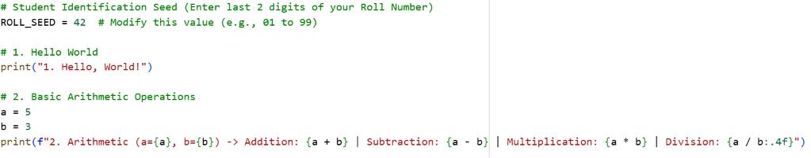
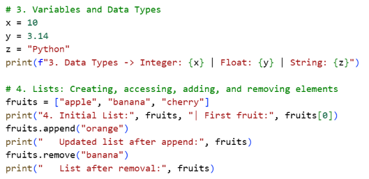

## Experiment 1: Python Fundamentals for Computational Mathematics

### Aim
Introduce core Python control structures, functions, lists, file operations, and exception handling through foundational mathematical routines.

### Algorithm
* **Step 1:** Execute a basic `print()` statement (`Hello, World!`) to verify the Python interpreter.
* **Step 2:** Define numerical variables $a$ and $b$ and perform addition, subtraction, multiplication, and division.
* **Step 3:** Declare variables of different data types (`int`, `float`, `str`) and inspect their values.
* **Step 4:** Create a Python list, access elements by index, append a new element, and remove an existing element.
* **Step 5:** Implement iterative control structures using `for` and `while` loops.
* **Step 6:** Implement conditional branching (`if`, `elif`, `else`) to classify numerical values.
* **Step 7:** Define and invoke reusable Python functions with input arguments and return values.
* **Step 8:** Perform file read/write operations (`open`, `write`, `read`) and handle runtime exceptions (`ZeroDivisionError`) using `try-except-finally` blocks.

### Case
Write and execute foundational Python programs demonstrating: (1) Hello World, (2) Basic Arithmetic Operations ($a=5, b=3$), (3) Variables and Data Types ($x=10, y=3.14, z=\text{"Python"}$), (4) List creation and manipulation (`fruits = ["apple", "banana", "cherry"]`), (5) `for` and `while` loops, (6) `if-elif-else` conditional statements, (7) Function definition and calling, (8) File reading and writing (`example.txt`), and (9) Exception handling for division by zero ($10/0$).

### Python code

Link to Lab file [Lab1 script:](https://colab.research.google.com/drive/1oDXBgewkOymNUxh7G4vCHbOLuR_R-zG7?usp=sharing)
